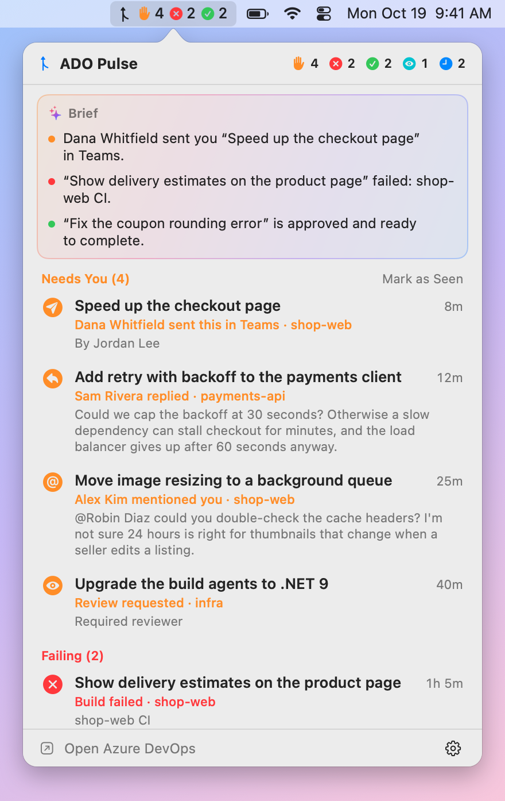
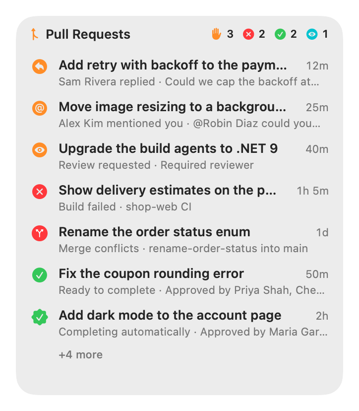

# ADO Pulse

[](https://github.com/mnsn/ado-pulse/actions/workflows/ci.yml)
[](LICENSE)

A small macOS menu-bar app, with an optional desktop widget, that shows your Azure DevOps pull
requests at a glance: which **need you** (a reply, a mention, a review request), which are
**failing**, which are **ready to complete**, and which are waiting on someone else.

It signs in with the Azure CLI, so there's no personal access token to create, and it only reads:
every request it makes is a GET. It's a sibling of [Copilot Pulse](https://github.com/mnsn/copilot-pulse),
and looks and works the same way.

<p align="center">
  <picture>
    <source media="(prefers-color-scheme: dark)" srcset="docs/images/menubar-dark.png">
    
  </picture>
  &nbsp;
  <picture>
    <source media="(prefers-color-scheme: dark)" srcset="docs/images/widget-large-dark.png">
    
  </picture>
</p>

> [!NOTE]
> ADO Pulse is an independent project. It isn't affiliated with or endorsed by Microsoft.

## Features

- **Menu bar**: the ADO Pulse icon, followed by a symbol and count for each group you can act on:
  orange ✋ needs you, red ✕ failing, green ✓ ready to complete, and, if you turn it on, teal 👁 to
  review. Click it to see every pull request by group.
- **A brief by Apple Intelligence**: at the top of the panel, one sentence each for the newest
  thing that needs you, the newest failure and the newest pull request that's ready. Comments are
  summarized on your Mac by its on-device model, one at a time.
- **Notifications** for new replies, mentions and comments, review requests, votes, new commits
  since your vote, failed builds, and pull requests that become ready or complete.
- **One click to the comment**: click a pull request to open it in your browser, scrolled to the
  thread that needs you.
- **Pull requests sent in chats** (if you turn it on): when someone sends you a link to a pull
  request in Teams, Slack, an email or any other app, it needs you too, as "Dana sent this in
  Teams". Right-click it to open the message.
- **Desktop widget**: a widget-style panel in three sizes, on the desktop behind your windows or
  floating above them. Drag it by its header, and right-click it for settings.
- **No token to manage**: it uses the Azure CLI's sign-in, which renews itself.
- **Finds your organizations**: the first time, it watches the ones where you have pull requests.
- **Private**: it only reads from Azure DevOps, summaries never leave your Mac, and it collects no data.

## What the groups mean

| Group | When |
|---|---|
| **Needs You** | Something new you haven't seen: a reply to your comment, a mention, a comment on your pull request, a review request, new commits since your vote, a reviewer who's waiting for you or rejected it, or a link to it someone sent you (if you turned that on) |
| **Failing** | Your pull request has a failed build or status check, merge conflicts, or a build that expired and has to run again |
| **Ready to Complete** | Your pull request is approved and every required policy passes (or it completes automatically) |
| **To Review** | Review requests you've seen but haven't voted on |
| **Waiting** | Your pull requests waiting for reviewers, a build or a requirement (such as a linked work item), and reviews you're waiting on the author for |
| **Done** | Completed or abandoned in the last day |
| **Idle** | Drafts, pull requests without activity for two weeks, and reviews you've approved or declined |

**Needs You** works like an inbox: opening a pull request from ADO Pulse, or clicking **Mark as
Seen**, moves it to its usual group until something new happens. Azure DevOps doesn't track what
you've read, so ADO Pulse keeps that itself. The first time it runs, only the last three days count
as new. Comments from build services and bots don't count.

## Install

Requires macOS 15 or later, on Apple silicon or Intel, and the
[Azure CLI](https://learn.microsoft.com/cli/azure/install-azure-cli-macos) signed in to your work
account. Summaries need Apple Intelligence (macOS 26 or later); everything else works without it.

1. Install the Azure CLI and sign in, if you haven't: `brew install azure-cli`, then `az login`.
   ADO Pulse can also start the sign-in for you.
2. Download [**ADO-Pulse.zip**](https://github.com/mnsn/ado-pulse/releases/latest/download/ADO-Pulse.zip)
   from the [latest release](https://github.com/mnsn/ado-pulse/releases/latest) and unzip it.
3. Drag **ADO Pulse** to your Applications folder before you open it. Opened from Downloads, macOS
   runs it from a temporary location, and Launch at Login may not work.
4. Open it. The app isn't notarized by Apple, so the first time, macOS won't open it because it
   can't verify it. Click **Done**, then go to **System Settings › Privacy & Security**, scroll down
   to the message that ADO Pulse was blocked, click **Open Anyway** and confirm.
5. Turn on **Launch at Login** in its settings. If macOS asks you to allow it, use
   **Allow in Login Items Settings…**. Allow its notifications too, when it asks.

The first time, it looks for your organizations, which takes a few seconds. To update, download the
latest release and replace the app; watch the repository's releases to hear about new ones. To
remove it, quit it and move it to the Trash.

On a Mac that your organization manages, **Open Anyway** may be missing. You can build ADO Pulse
from source instead.

### Build from source

You need Swift 6 from Xcode or the Command Line Tools (`xcode-select --install`). An app you build
yourself opens without the Gatekeeper step.

```sh
git clone https://github.com/mnsn/ado-pulse.git
cd ado-pulse
make install     # builds "ADO Pulse.app", copies it to ~/Applications and launches it
```

Then turn on **Launch at Login** as above. To update, pull and run `make install` again; to remove
it, run `make uninstall`. If you'll use **Pull Requests Sent in Chats**, run `make signing-identity`
once before `make install`, so the Full Disk Access you give it survives the next build. When macOS
asks whether codesign may use the new key, enter your login password and choose **Always Allow**.

## Signing in

ADO Pulse asks the Azure CLI for an Azure DevOps token (`az account get-access-token`), the way
`az` itself works, so it needs no personal access token, which many organizations block. The CLI
renews its sign-in by itself, usually for months.

If the CLI isn't signed in, the panel says so, and **Sign In…** opens Terminal to run `az login`,
which signs you in through your browser. ADO Pulse notices within a minute. It finds `az` in
`/opt/homebrew/bin`, `/usr/local/bin` and the other usual places, or through your login shell. Set
`ADO_PULSE_AZ` to the path of `az` to use another one.

## Settings

Open the gear menu in the menu-bar panel, or right-click the widget.

| Setting | Options |
|---|---|
| Notifications | on/off. If macOS blocks them, the panel offers to open System Settings |
| Summaries by Apple Intelligence | on/off, when Apple Intelligence is available |
| Show To Review in the Menu Bar | off by default |
| Pull Requests Sent in Chats | off by default. Needs Full Disk Access: see [the FAQ](#how-does-it-find-pull-requests-people-send-me) |
| Show Desktop Widget | on/off |
| Widget Position | **On Desktop (Behind Windows)** like a real widget, or **Floating (Above Windows)** |
| Widget Size | Compact (2 rows), Medium (4), Large (8) |
| Refresh | every 1, 2 or 5 minutes |
| Keep Done For | 4 hours, 1 day, 3 days |
| Idle After No Activity For | 1 week, 2 weeks, 1 month, never |
| Organizations | which to watch; **Add Organization…** takes a name or any link from it |
| Launch at Login | on/off |

## Privacy

- ADO Pulse reads from Azure DevOps with your Azure CLI sign-in. It never changes anything there:
  every request is a GET, to `dev.azure.com` and, to find your organizations,
  `app.vssps.visualstudio.com`.
- Summaries are written by Apple Intelligence's on-device model. ADO Pulse never uses Private Cloud
  Compute or any other model, so no comment or title leaves your Mac.
- If you turn on **Pull Requests Sent in Chats**, ADO Pulse reads the notifications that macOS keeps
  in Notification Center, from every app, to find links to pull requests. It keeps only the links,
  with who sent them, in which app and when, never the messages, and sends nothing anywhere. Turning
  it off forgets them.
- It stores its settings, and when you last opened each pull request from it, in its preferences on
  your Mac. It collects no data and sends nothing anywhere else.

## FAQ

### Why does it poll instead of getting pushed updates?

Azure DevOps can only push changes through service hooks, which need a project administrator and a
server on the internet. So ADO Pulse asks every minute: three requests per organization for your
lists, plus two for each pull request whose details it refreshes. New and changed pull requests are
refreshed right away, the rest every few minutes (drafts and idle ones less often). That's about
10 to 25 small requests a minute. It also refreshes when you open the panel, when your Mac wakes,
and when it's back online. [How it works](docs/how-it-works.md) has the details.

### How does it find pull requests people send me?

When you turn on **Pull Requests Sent in Chats**, ADO Pulse looks for links to Azure DevOps pull
requests in the notifications macOS keeps in Notification Center: Teams, Slack, Outlook, Mail or any
other app's. It doesn't need Teams or any other app to cooperate. In Teams, only chat messages count,
not channel posts or reactions, and emails from Azure DevOps itself don't count.

macOS protects Notification Center's database, so ADO Pulse needs **Full Disk Access**. It shows you
how to grant it when you turn the setting on. A pull request someone sent you needs you until you
open it from ADO Pulse, vote or comment on it, it closes, or a week goes by. Notification Center
keeps only the latest hundred or so notifications per app, so ADO Pulse remembers the links it finds
(only the links, as described in [Privacy](#privacy)).

macOS ties Full Disk Access to the app's signature. Every release is signed with the same
certificate, so updating keeps it. A copy you build yourself keeps it across builds once you've run
`make signing-identity`; otherwise you have to allow each new build again.

### Why isn't a pull request assigned to my team shown?

Azure DevOps's search for "pull requests I review" only matches you, not the groups you're in. Pull
requests where you were added yourself, including by a policy, are shown.

### Why does a failed build show no error details?

Azure DevOps doesn't include a build's errors with a pull request's policies, so the panel shows
which build failed. Click the pull request to see it.

### Why isn't it notarized?

Notarization needs a paid Apple Developer Program membership, which this free project doesn't
have. So macOS asks you to allow the app the first time you open it, as described in
[Install](#install). Each release is built from its tagged source by
[GitHub Actions](.github/workflows/release.yml) and signed with the project's own certificate, with
an attestation you can [verify](SECURITY.md#verifying-a-download). You can also build it yourself.

### How do I troubleshoot it?

The app binary has command-line modes, and logs diagnostics to the system log:

```sh
APP="$HOME/Applications/ADO Pulse.app/Contents/MacOS/ADOPulse"
"$APP" --dump     # every pull request and its status
"$APP" --watch    # changes as they happen
"$APP" --orgs     # your organizations, and the ones with pull requests
log show --last 10m --info --predicate 'subsystem == "com.asaf.ADOPulse"' --style compact
```

Their output includes your pull requests' titles and comments, so remove anything private before
you share it.

## Contributing

Bug reports, ideas and pull requests are welcome. [CONTRIBUTING.md](CONTRIBUTING.md) explains how
to build, test and try the app with made-up pull requests. Please report security issues privately
as described in [SECURITY.md](SECURITY.md).

## License

Copyright © 2026 Asaf Manassen. ADO Pulse is free software, licensed under the
[GNU General Public License v3.0 or later](LICENSE).

Microsoft, Azure and Azure DevOps are trademarks of the Microsoft group of companies. Apple
Intelligence is a trademark of Apple Inc.
